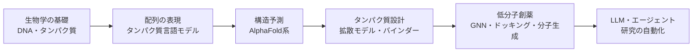

## はじめに

ここ数年の AI の進歩を見ると、次に大きな変化が起きる分野の1つは**生命科学**だと考えられます。一方で、生物の専門知識がないソフトウェアエンジニアにとって、バイオAIは入り口が見えにくい分野でもあります。

そこで、**「生物の専門知識がないソフトウェアエンジニアが、最先端のバイオAIを理論と実践の両面から学ぶ」** 連載を始めます。学習の過程をそのまま教材としてまとめるので、同じような立場の方の役に立てばうれしいです。

:::note info
**この連載の方針**
- **論文を読んで、コードを動かす**ことを重視します。数式の厳密な導出は最小限にします
- 生物の知識は**必要になったときに必要な分だけ**説明します
- コードはすべて **Google Colab の無料枠**で動く範囲にします（GPU を持っていなくても大丈夫です）
- ハンズオンのコードはすべて記事の中に載せています。Colab のセルに貼り付ければ、そのまま実行できます
:::

### 想定読者

- Python と機械学習の基礎（PyTorch や Transformer の概要）がわかる方
- 生物は高校で習った程度、あるいはほとんど覚えていない方
- 「AlphaFold はよく聞くけれど、何がすごいのかよくわからない」という方

## なぜ今バイオAIなのか

### 1. ノーベル賞が示した転換点

2024年のノーベル化学賞は、タンパク質の構造予測 AI **AlphaFold** を開発した Demis Hassabis 氏と John Jumper 氏（Google DeepMind）、そしてタンパク質の計算設計を切り拓いた David Baker 氏に贈られました。

同じ2024年には、ノーベル物理学賞も、ニューラルネットワークによる機械学習の基盤を築いた John Hopfield 氏と Geoffrey Hinton 氏に贈られています[^nobel-phys]。AI に関わる研究が、2つのノーベル賞を同時に受けた年でした。

化学賞の対象となった AlphaFold は、50年来の難問だった「アミノ酸の配列から立体構造を予測する問題」を、実用に耐える精度で解きました。

### 2. 「予測」から「設計」へ

AlphaFold2（2020年）が実現したのは構造の**予測**でした。ここ数年の流れは、さらに進んで**設計（生成）** に向かっています。

| 時期 | 出来事 | 意味 |
|---|---|---|
| 2020–21 | AlphaFold2 | 単一タンパク質の構造を、実験に迫る精度で予測 |
| 2022–23 | ESM-2 / ESMFold、RFdiffusion、ProteinMPNN | 言語モデルや拡散モデルがタンパク質に応用される |
| 2024 | AlphaFold3 | タンパク質と DNA・低分子などの**複合体**も予測できるようになる |
| 2024–25 | Boltz-1/2、Chai-1、OpenFold3 | AlphaFold3 級のモデルが**オープンソース**化され、Boltz-2 は結合親和性の予測にも対応 |
| 2025 | BoltzGen、RFdiffusion3 など | 新しい標的に結合するタンパク質（バインダー）を、**ゼロから**設計。BoltzGen は高い成功率を報告し、RFdiffusion3 は全原子レベルでの設計に対応 |

GAN や拡散モデルで画像を生成するのと同じ発想で、**「狙った機能を持つ分子を生成する」** ことが現実になりつつあります。

### 3. 創薬の現場に入ってきた AI

研究室の中だけの話ではありません。

- Insilico Medicine は、標的の探索から化合物の設計まで AI で進めた特発性肺線維症の治療薬候補（rentosertib）について、第IIa相臨床試験の結果を 2025年に *Nature Medicine* で報告しました[^rentosertib]
- AlphaFold の技術をもとにした DeepMind 系の創薬企業 Isomorphic Labs は、2026年1月に、最初の臨床試験を2026年末までに始める見通しだと CEO が述べたと報じられています[^isomorphic]

### 4. LLM・エージェント技術との合流

もう一つの大きな流れが、**LLM やエージェントがバイオ研究そのものを自動化する**動きです。論文を検索し、ツールを呼び出して構造を予測し、実験計画を立てる「AI 科学者」の研究が急速に増えています。

ここは RAG やエージェントを作ってきたエンジニアの経験をそのまま活かせる分野です。**生物の専門家ではないエンジニアにも、貢献できる余地が大きい**分野です。

## バイオAIの全体像

バイオAIの範囲はとても広いので、この連載では次の流れに絞ります。



**タンパク質のモデリング**から入って、段階的に**創薬**へ近づいていく構成です。

### エンジニア向けの「対応表」

生物の概念は、実はソフトウェアの概念に置き換えると理解しやすいものが多いです。連載全体で使う見取り図として載せておきます（厳密な対応ではなく、あくまで直感をつかむためのたとえです）。

| 生物の概念 | エンジニア的なたとえ | 登場する章 |
|---|---|---|
| DNA | ソースコード（4文字 A/T/G/C で書かれている） | #01 |
| 遺伝子 | 関数・モジュール | #01 |
| RNA | DNA から写し取られる中間表現（実行用のコピー） | #01 |
| タンパク質 | 実行されるプログラム／動作する部品（20種類のアミノ酸の列） | #01, #02 |
| 立体構造 | 実行時の状態。形が機能を決める | #02 |
| 進化（変異と選択） | 大量の A/B テストの結果残ったコード | #04 |
| タンパク質言語モデル | 生物版の BERT／GPT | #04 |
| 薬（低分子）が標的に結合する | 特定の API にだけ刺さるリクエスト | #12 |

## 連載の目次

各章は**理論（論文の要点）→ハンズオン（Colab）** の二部構成です。

| # | タイトル | 主なトピック |
|---|---|---|
| 00 | **はじめに（本記事）** | 全体像、環境準備、最初のハンズオン |
| 01 | セントラルドグマ | DNA→RNA→タンパク質を「情報処理」として理解する |
| 02 | タンパク質の構造と機能 | アミノ酸、折りたたみ、結合 |
| 03 | バイオデータとツール | FASTA / PDB / SMILES、UniProt、Biopython、RDKit |
| 04 | タンパク質言語モデル | ESM-2 / ESM C、埋め込み、変異の影響の予測 |
| 05 | AlphaFold2 の仕組み | MSA、Evoformer、構造モジュール |
| 06 | AlphaFold3 と共折りたたみモデル | Boltz-2 / Chai-1 / OpenFold3、複合体と結合親和性の予測 |
| 07 | GAN から拡散モデル・Flow Matching へ | 生成モデルの系譜 |
| 08 | タンパク質デザイン | RFdiffusion → ProteinMPNN → 構造予測による検証 |
| 09 | バインダー設計の最前線 | BindCraft、BoltzGen、抗体デザイン |
| 10 | マルチモーダル生成モデル | ESM3 など |
| 11 | 分子表現と GNN | 分子グラフ、物性・ADMET の予測 |
| 12 | ドッキングと結合予測 | DiffDock、PoseBusters による評価 |
| 13 | 分子生成 | 構造ベースの低分子生成 |
| 14 | バイオ RAG | PubMed と DB を使った研究アシスタント |
| 15 | バイオAI エージェント | ツール呼び出しで動く研究エージェント |
| 16 | 総合ハンズオン | 標的→構造→設計→評価の自動化パイプライン |
| 17 | 倫理と展望 | バイオセキュリティ、仮想細胞、ゲノム言語モデル |

:::note warn
この分野は数か月単位で新しいモデルが出てきます。各章を書く時点で最新の情報を調べ直すので、目次の中身は変わることがあります。
:::

## 環境準備：Google Colab

この連載では、ブラウザだけで Python と GPU が使える [Google Colab](https://colab.research.google.com/) を使います。

1. Google アカウントで Colab を開き、「ノートブックを新規作成」を選びます
2. GPU が必要な章では、メニューの **「ランタイム」→「ランタイムのタイプを変更」→「T4 GPU」** を選びます
3. 次のセルで GPU が使えるかどうか確認できます

```python
!nvidia-smi
```

:::note info
**無料枠の制約**
- GPU は T4（GPU メモリ 16GB）で、利用時間に上限があります（混雑状況によって変わります）
- 一定時間操作しないとセッションが切れ、インストールしたライブラリは消えます
- 大きなモデルを扱う章では、軽量な設定や公開 API を使う方法を、代替案として紹介します
:::

## 最初のハンズオン：タンパク質を「見て」みる

今回は GPU なしで動く簡単なハンズオンです。**緑色蛍光タンパク質（GFP）** を例に、

1. アミノ酸配列（＝タンパク質の「ソースコード」）を取得し
2. 実験で決められた立体構造を表示し
3. AlphaFold が予測した構造と見比べます

GFP はクラゲ由来の光るタンパク質で、生命科学の実験で目印として広く使われています（2008年のノーベル化学賞の対象です）。

Colab で新しいノートブックを作成し、以下のコードを Step 1 から順にセルへ貼り付けて実行してください。

### Step 1：ライブラリのインストール

```python
!pip install -q biopython py3Dmol requests
```

### Step 2：UniProt からアミノ酸配列を取得する

[UniProt](https://www.uniprot.org/) は、タンパク質の配列と機能の情報をまとめた世界最大級のデータベースです。GFP の ID は `P42212` です。

```python
import requests
from io import StringIO
from collections import Counter
from Bio import SeqIO

UNIPROT_ID = "P42212"  # GFP (Aequorea victoria)

fasta = requests.get(f"https://rest.uniprot.org/uniprotkb/{UNIPROT_ID}.fasta").text
record = SeqIO.read(StringIO(fasta), "fasta")

print(record.description)
print(f"長さ: {len(record.seq)} アミノ酸")
print(record.seq)
```

出力のイメージです。

```
sp|P42212|GFP_AEQVI Green fluorescent protein OS=Aequorea victoria ...
長さ: 238 アミノ酸
MSKGEELFTGVVPILVELDGDVNGHKFSVSGEGEGDATYGKLTLKFICTTGKLPVPWPTLVTTFSYGVQCFSRYPDHMKQ...
```

この `M`、`S`、`K`、`G` … の1文字1文字が、それぞれ1つの**アミノ酸**を表しています。タンパク質は20種類のアミノ酸がつながった「文字列」で、GFP は238文字の文字列というわけです。

文字の出現頻度も見てみましょう。

```python
for aa, n in Counter(record.seq).most_common(5):
    print(aa, n)
```

:::note info
LLM が単語やトークンの列を扱うように、**タンパク質言語モデル**（#04）はこのアミノ酸の列をそのまま「文章」として学習します。
:::

### Step 3：実験で決められた立体構造を表示する

タンパク質の立体構造は [PDB（Protein Data Bank）](https://www.rcsb.org/) に登録されています。GFP の代表的な構造 `1EMA` を表示してみます。

```python
import py3Dmol

view = py3Dmol.view(query="pdb:1EMA", width=600, height=450)
view.setStyle({"cartoon": {"color": "spectrum"}})
view.zoomTo()
view.show()
```

マウスでぐるぐる回せます。ひもが**樽（バレル）のような形**に折りたたまれているのが見えるはずです。この樽の内側で、光を出す部分（発色団）が守られています。

**1次元の文字列が、3次元の決まった形に折りたたまれる。** そして**形が機能を決める**。これがバイオAIを理解するうえで一番大事なポイントです（#02 で詳しく説明します）。

### Step 4：AlphaFold の予測構造と比べる

[AlphaFold Protein Structure Database](https://alphafold.ebi.ac.uk/) には、2億件以上のタンパク質について AlphaFold が予測した構造が公開されています。

```python
meta = requests.get(f"https://alphafold.ebi.ac.uk/api/prediction/{UNIPROT_ID}").json()[0]
pdb_text = requests.get(meta["pdbUrl"]).text

view = py3Dmol.view(width=600, height=450)
view.addModel(pdb_text, "pdb")
# AlphaFold の PDB ファイルでは、B-factor 列に信頼度 pLDDT（0〜100）が入っている
view.setStyle({"cartoon": {"colorscheme": {"prop": "b", "gradient": "roygb", "min": 50, "max": 90}}})
view.zoomTo()
view.show()
```

色は予測の**信頼度（pLDDT）** を表しています。青に近いほど信頼度が高く、赤に近いほど低いです。

実験で決めた構造（Step 3）とほとんど同じ樽型が予測されていることがわかります。アミノ酸配列を入力として、ここまでの構造を予測できるのが AlphaFold のすごさです。ただし、両端の部分は赤っぽく（信頼度が低く）表示されることがあります。実際のタンパク質でも、端の部分は柔軟に動きやすく、形が定まりにくいことが多いためです。

:::note info
**pLDDT の目安**
- 90 以上：非常に信頼できる
- 70〜90：おおむね信頼できる
- 50〜70：信頼度は低い
- 50 未満：決まった構造を持たない（天然変性）領域の可能性がある
:::

## まとめ

- バイオAIは、構造の**予測**（AlphaFold）から、分子の**設計**（生成モデル）、そして**研究の自動化**（エージェント）へと広がっています
- タンパク質は「20種類の文字でできた文字列」で、それが立体構造に折りたたまれて機能します
- 数行の Python で、配列の取得・構造の表示・AI による予測構造との比較までできます

次回（#01）は、DNA→RNA→タンパク質という生命の情報の流れ「**セントラルドグマ**」を、エンジニアの視点で整理します。

## 参考文献・リンク

- Jumper, J. et al. "Highly accurate protein structure prediction with AlphaFold." *Nature* 596, 583–589 (2021).
- Abramson, J. et al. "Accurate structure prediction of biomolecular interactions with AlphaFold 3." *Nature* 630, 493–500 (2024).
- [The Nobel Prize in Chemistry 2024 – NobelPrize.org](https://www.nobelprize.org/prizes/chemistry/2024/summary/)
- [UniProt](https://www.uniprot.org/) / [RCSB PDB](https://www.rcsb.org/) / [AlphaFold Protein Structure Database](https://alphafold.ebi.ac.uk/)
- [Boltz（GitHub）](https://github.com/jwohlwend/boltz)

[^nobel-phys]: NobelPrize.org, "The Nobel Prize in Physics 2024". https://www.nobelprize.org/prizes/physics/2024/summary/
[^rentosertib]: Xu, Z. et al. "A generative AI-discovered TNIK inhibitor for idiopathic pulmonary fibrosis: a randomized phase 2a trial." *Nature Medicine* (2025).
[^isomorphic]: Reuters, "Google-backed Isomorphic Labs delays clinical trial timeline", 2026-01-20. https://www.reuters.com/business/healthcare-pharmaceuticals/google-backed-ai-drug-discovery-startup-isomorphic-labs-delays-clinical-trial-2026-01-20/
